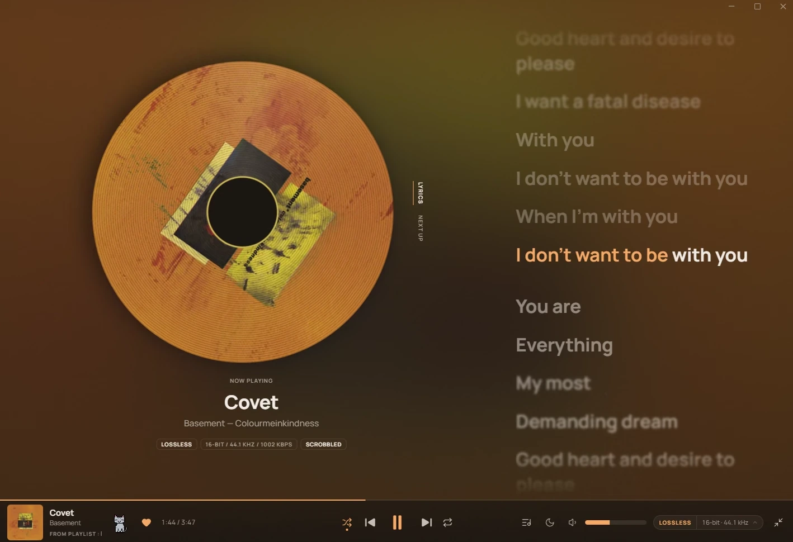

<p align="center">
  
</p>

<h1 align="center">OxiTide Electron</h1>

<p align="center">
  <a href="https://github.com/Zephulbr/OxiTide">OxiTide</a>'s interface in Chromium instead of WebKitGTK, for Linux.<br>
  Same Rust backend, same Svelte UI, much better rendering on NVIDIA and high-refresh Wayland desktops.
</p>

<p align="center">
  <a href="LICENSE"></a>
  
  
</p>

<p align="center">
  
</p>

> [!NOTE]
> This is an unofficial fork of [Zephulbr/OxiTide](https://github.com/Zephulbr/OxiTide), an unofficial TIDAL client.
> It's not affiliated with or endorsed by TIDAL or the OxiTide project. The original project's README, with the
> feature list and screenshots of every mode, is in [`README.upstream.md`](README.upstream.md).

## Why this fork exists

OxiTide is built with [Tauri 2](https://tauri.app). On Linux, Tauri draws its UI with **WebKitGTK**. On some setups,
especially NVIDIA GPUs on Wayland with 144–240 Hz monitors, WebKitGTK scrolls and animates at a few frames per second.
Toggling `WEBKIT_DISABLE_COMPOSITING_MODE`, `WEBKIT_DISABLE_DMABUF_RENDERER`, Skia CPU painting or XWayland didn't
fix it on the machine this fork was made on. Other WebKitGTK music apps on the same machine have the same problem.

The UI itself is fine. Its engine is the problem. This fork keeps all of OxiTide (the bit-perfect audio engine, TIDAL
API client, tray, MPRIS, global hotkeys, phone remote, scrobbling and every UI mode) and only changes **what draws the
window**: Electron's Chromium, which uses GPU compositing on those same machines.

## How it works

```
┌──────────────────────────────┐      Unix socket ($XDG_RUNTIME_DIR, 0600)      ┌─────────────────────────────────┐
│ Electron (Chromium)          │   one JSON object per line, both directions    │ oxitide-app (Rust, unchanged)   │
│                              │ ─────────────────────────────────────────────▶ │                                 │
│  Svelte UI (ui/)             │   invoke(cmd, args) / listen(event)            │  Tauri runtime, hidden window   │
│  @tauri-apps/* → shims       │ ◀───────────────────────────────────────────── │  on a blank page: IPC only      │
│  (ui/src/shell/)             │   results, events, window requests             │  audio engine · TIDAL · tray ·  │
│                              │   (show/hide/toggle, mini player, zoom)        │  MPRIS · hotkeys · remote       │
└──────────────────────────────┘                                                └─────────────────────────────────┘
```

- **Backend: shell mode.** With `OXITIDE_SHELL=electron`, `oxitide-app` starts as usual, but its WebKitGTK window
  loads an empty page and is never shown. A bridge ([`crates/oxitide-app/src/shell.rs`](crates/oxitide-app/src/shell.rs))
  connects to the socket Electron created. It runs each `invoke` through Tauri's real IPC path (`Webview::on_message`),
  so ACLs, argument parsing and sync/async command dispatch behave exactly as in the Tauri app. It also forwards any event the
  UI listens to. Window actions that used to move the Tauri window (tray toggle, second launch, MPRIS Raise, mini
  player, interface zoom) are sent to Electron instead.
- **UI: unchanged components.** `vite build --mode electron` aliases `@tauri-apps/api/{core,event,window}` and
  `@tauri-apps/plugin-opener` to small shims ([`ui/src/shell/`](ui/src/shell/)) that talk to the preload bridge.
  No Svelte component was edited.
- **Shell: Electron.** [`electron/main.cjs`](electron/main.cjs) starts the backend, serves the built UI over a private
  `app://` scheme with a strict CSP (inline scripts allowed by hash, as Tauri does), uses the native window frame, and
  handles `tidal://` login links on a second launch. Chromium's own media-key handling is turned off, because the backend
  owns MPRIS.

Outside shell mode, nothing changes: `npm --prefix ui run app:build` still produces the normal Tauri app.

## Status

Experimental. Tested on one machine: Bazzite (Fedora 45, KDE Plasma 6.8 on Wayland), RTX 3060 Ti, NVIDIA 620.70, a
240 Hz and a 180 Hz monitor, Electron 45.2.3.

| Area | State |
| --- | --- |
| UI loads with no errors, GPU compositing on (`app.getGPUFeatureStatus()`) | ✅ |
| Backend commands and events over the bridge | Working in first runs; broader testing ongoing |
| Session restore, playback, tray, mini player, zoom, `tidal://` login | Implemented, not fully tested yet |
| AutoMix lab (raw binary IPC response) | Implemented, untested |
| Windows / macOS | Not supported: shell mode is Unix-only (the Tauri build there is unaffected) |
| Self-update | Off: the upstream updater only installs over AppImages |

## Build

You need the [Tauri Linux prerequisites](docs/linux-build.md) (WebKitGTK 4.1, GTK 3, libayatana-appindicator,
ALSA and D-Bus headers), Rust (the version pinned in `rust-toolchain.toml`, installed by rustup) and **Node 24**.

```bash
git clone https://github.com/shikiwoo/OxiTide-Electron.git
cd OxiTide-Electron
./electron/build.sh
```

`build.sh` installs the UI dependencies, builds the UI twice (the normal build is embedded in the backend for the phone
remote, and the Electron build is what the window shows), compiles `oxitide-app` in release mode, and downloads the pinned
Electron binary (checksum-verified by the `electron` package).

<details>
<summary>On an immutable distro (Bazzite, Silverblue, Kinoite…)</summary>

Build in an Ubuntu 24.04 [distrobox](https://distrobox.it) with the packages from `docs/linux-build.md` and Node 24, then
**run on the host**, so Chromium gets your GPU driver. The backend only needs WebKitGTK 4.1, GTK 3, libappindicator3
and libxdo at runtime, and Fedora-based images ship them.

```bash
distrobox enter oxitide-dev -- ./electron/build.sh
./electron/run.sh
```
</details>

## Run

```bash
./electron/run.sh     # starts Electron, which starts the backend
./electron/stop.sh    # stops both
```

Closing the window follows OxiTide's **close to tray** setting. Quitting from the tray, or closing with that setting
off, shuts down both processes, and the backend saves the session and history first.

A desktop entry for the launcher and for `tidal://` links (the browser login redirects there):

```ini
[Desktop Entry]
Type=Application
Name=OxiTide
Exec=/path/to/OxiTide-Electron/electron/run.sh %u
Icon=oxitide-app
Categories=AudioVideo;Audio;Music;
StartupWMClass=oxitide-electron
MimeType=x-scheme-handler/tidal;
```

Save it as `~/.local/share/applications/oxitide-electron.desktop`, then run
`xdg-mime default oxitide-electron.desktop x-scheme-handler/tidal`.

**Debugging:** `OXITIDE_SHELL_DEBUG=1 ./electron/run.sh` logs Chromium's GPU status after the page loads. UI warnings and
errors always go to the shell's stdout, and backend logs go to `~/.config/oxitide/logs/`.

## Things to know

- **Shares data with OxiTide.** It's the same app (`org.codeberg.zephulbr.oxitide`): same config, cache, keyring entry
  and login. Don't run it alongside an upstream OxiTide install, because the single-instance check makes the second one exit.
- **Login** works as upstream: your browser opens TIDAL's login page, and you either let it redirect to `tidal://` or
  paste the final URL back into the app.
- **Memory:** Chromium costs more RAM than WebKitGTK. That's the trade-off for smooth rendering.
- Upstream's [privacy notes](README.upstream.md#privacy-and-security) apply unchanged. The Electron shell adds no network
  access: the page may only load TIDAL artwork, and everything else goes through the backend.

## Keeping up with upstream

The fork is upstream `main` plus a small, self-contained set of changes:

| Where | What |
| --- | --- |
| `crates/oxitide-app/src/shell.rs` | The bridge (new) |
| `main.rs`, `window.rs`, `tray.rs`, `commands.rs` | A few `if shell::electron()` branches |
| `ui/src/shell/`, `ui/vite.config.ts`, `ui/public/shell-blank.html` | Shims and the `electron` build mode |
| `electron/` | The Electron app and scripts |

```bash
git remote add upstream https://github.com/Zephulbr/OxiTide.git
git fetch upstream && git rebase upstream/main
```

After a rebase, check for new `@tauri-apps/*` imports in `ui/src` and for new code that uses the Tauri window directly
(`get_webview_window`, `tauri::WebviewWindow` parameters) in `crates/oxitide-app/src`. Those need a shim or a shell
branch.

## License and credits

[AGPL-3.0-or-later](LICENSE), like upstream. All of OxiTide is the work of
[Zephulbr and its contributors](https://github.com/Zephulbr/OxiTide). See [`THIRD_PARTY_NOTICES.md`](THIRD_PARTY_NOTICES.md).
This fork only adds the Electron shell. TIDAL is a trademark of its owner; this project is not affiliated with it.
