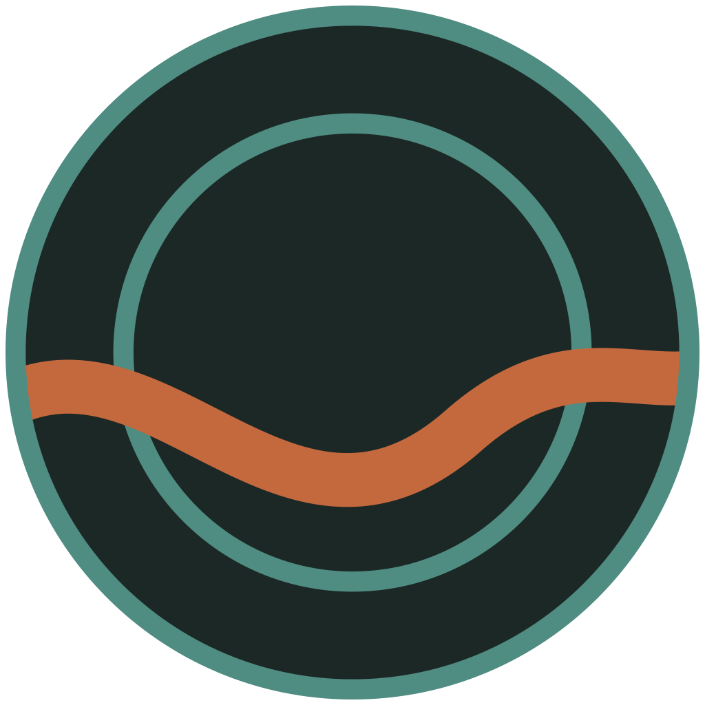

<p align="center">
  
</p>

<h1 align="center">OxiTide Electron</h1>

<p align="center">
  A fork of <a href="https://github.com/Zephulbr/OxiTide">OxiTide</a>, the unofficial TIDAL desktop client.<br>
  On Linux it draws the UI with Chromium (Electron) instead of WebKitGTK. It also builds for Windows and macOS.
</p>

<p align="center">
  <a href="LICENSE"></a>
  
  
</p>

<p align="center">
  
</p>

> [!NOTE]
> An unofficial fork of an unofficial client. It isn't affiliated with or endorsed by TIDAL or the OxiTide project.
> OxiTide's own README, with the full feature list and screenshots of every mode, is
> [`README.upstream.md`](README.upstream.md).

## What this fork is

OxiTide is a Tauri 2 app: a Rust backend (bit-perfect audio engine, TIDAL API client, tray, media keys, global hotkeys,
phone remote, scrobbling) under a Svelte 5 UI. This fork keeps all of that and adds:

| Change | Platforms |
| --- | --- |
| **Electron shell.** The UI runs in Chromium over the unchanged Rust backend (see [How the Electron shell works](#how-the-electron-shell-works)) | Linux |
| **AppImage** of the Electron build, published as GitHub Releases | Linux |
| **macOS port:** Core Audio output, Now Playing / media keys, Keychain login, universal `.dmg` | macOS |
| **Persistent title bar:** a solid strip with the app's mark and name over the undecorated window, instead of an invisible drag band | Windows |
| **Updater pointed at this fork** (`tauri.fork.conf.json`), so an install never "updates" to upstream OxiTide | Windows, macOS |
| **UI changes:** share button in the player bar and *Copy link* in track menus; track-list pages scroll as one (header and rows together); album, playlist and mix titles wrap to two lines across the full header width | All |

The fork is based on upstream **1.1.8**. Its versions add a fork revision: `1.1.8-1` is the first fork release on top
of upstream 1.1.8.

### Why the Electron shell

On Linux, Tauri draws its UI with **WebKitGTK**. On some setups, especially NVIDIA GPUs on Wayland with 144–240 Hz
monitors, WebKitGTK scrolls and animates at a few frames per second, and none of the usual switches
(`WEBKIT_DISABLE_COMPOSITING_MODE`, `WEBKIT_DISABLE_DMABUF_RENDERER`, Skia CPU painting, XWayland) fixed it on the
machine this fork was made on. The UI isn't the problem; the engine drawing it is. Electron's Chromium uses GPU
compositing on those same machines.

Windows (WebView2) and macOS (WKWebView) already render the UI well, so they use the regular Tauri shell.

## Status

Experimental.

| Platform | Shell | How it's built | State |
| --- | --- | --- | --- |
| Linux | Electron 45 (Chromium) | AppImage from CI on every push to `main`; Releases for `electron-v*` tags | Main target of the fork. Tested on Bazzite (Fedora, KDE Plasma 6 on Wayland), RTX 3060 Ti, 240 Hz + 180 Hz monitors. Session restore, tray, mini player, zoom, `tidal://` login and the AutoMix lab are implemented but not fully tested |
| Windows | Tauri (WebView2) | NSIS installer from the manual **Windows installer** workflow, or locally | Builds and runs |
| macOS | Tauri (WKWebView) | Unsigned universal `.dmg` from the **macOS app** workflow | Builds and passes its tests in CI; untested on a Mac |

Self-update: off in the Electron shell (download new AppImages from Releases). The Windows and macOS builds made with
`tauri.fork.conf.json` check this repository's Releases, but releases don't include an updater manifest yet, so in
practice they never update themselves.

## Install

### Linux (AppImage)

Download `OxiTide-Electron-<version>-x86_64.AppImage` from
[Releases](https://github.com/shikiwoo/OxiTide-Electron/releases), or a newer build from the **Artifacts** of the latest
[AppImage (Electron)](https://github.com/shikiwoo/OxiTide-Electron/actions/workflows/appimage.yml) run (kept 14 days).

```bash
chmod +x OxiTide-Electron-*-x86_64.AppImage
./OxiTide-Electron-*-x86_64.AppImage
```

- **System libraries:** the AppImage bundles Electron, but the backend uses the system's **WebKitGTK 4.1**, GTK 3,
  libayatana-appindicator3 (or libappindicator3) and libxdo. Most desktops have them: Fedora/Bazzite, Ubuntu 22.04+
  (`libwebkit2gtk-4.1-0`), Debian 12+, Arch (`webkit2gtk-4.1`).
- **Sandbox:** electron-builder starts AppImages with `--no-sandbox`, because Chromium's setuid sandbox helper can't run
  from a read-only AppImage mount. The window only loads the app's own files and TIDAL artwork.
- **Menu entry and `tidal://` login:** use an AppImage integrator (Gear Lever, AppImageLauncher), or the desktop entry
  under [Run from a checkout](#run-from-a-checkout) with `Exec=/path/to/OxiTide-Electron.AppImage %u`.

### Windows

Run **Actions → Windows installer → Run workflow** and download `OxiTide-windows-nsis`, or build it yourself
([Build → Windows](#windows-1)). The installer is per-user and unsigned, so SmartScreen may warn on first run. WebView2
downloads at install time if it's missing.

### macOS

Run **Actions → macOS app → Run workflow** and download `OxiTide-macos-dmg`. The app is unsigned: after copying it to
Applications, clear the quarantine flag once with `xattr -cr /Applications/OxiTide.app`.

## Build

All platforms need Rust (the version pinned in `rust-toolchain.toml`; rustup installs it) and **Node 24**.

### Linux (Electron)

You also need the [Tauri Linux prerequisites](docs/linux-build.md) (WebKitGTK 4.1, GTK 3, libayatana-appindicator,
ALSA and D-Bus headers).

```bash
git clone https://github.com/shikiwoo/OxiTide-Electron.git
cd OxiTide-Electron
./electron/build.sh                 # build everything
./electron/package.sh [version]     # optional: an AppImage in electron/out/dist/
```

`build.sh` installs the UI dependencies, builds the UI twice (the normal build is embedded in the backend for the phone
remote; the Electron build is what the window shows), compiles `oxitide-app` in release mode and downloads the pinned
Electron binary (checksum-verified by the `electron` package).

<details>
<summary>On an immutable distro (Bazzite, Silverblue, Kinoite…)</summary>

Build in an Ubuntu 24.04 [distrobox](https://distrobox.it) with the packages from `docs/linux-build.md` and Node 24, then
**run on the host**, so Chromium gets your GPU driver. At runtime the backend only needs WebKitGTK 4.1, GTK 3,
libappindicator3 and libxdo, which Fedora-based images ship.

```bash
distrobox enter oxitide-dev -- ./electron/build.sh
./electron/run.sh
```
</details>

### Windows

```powershell
npm --prefix ui ci
npm --prefix ui run app:build -- --config crates/oxitide-app/tauri.fork.conf.json --bundles nsis
```

The installer lands in `target/release/bundle/nsis/`. Leave out `--config …` and the build's updater points at
upstream OxiTide, which would offer to replace it with an upstream release.

### macOS

The **macOS app** workflow builds the `.dmg`. To type-check the macOS code from Linux (inside `oxitide-dev`, with `clang`
and `rustup target add aarch64-apple-darwin`): `scripts/check-macos.sh`, or
`CARGO_CMD=clippy scripts/check-macos.sh -- -D warnings`.

### Development

The regular Tauri dev loop works on every platform: `npm --prefix ui install` once, then `npm --prefix ui run app:dev`.
Checks: `npm --prefix ui run check`, `npm --prefix ui test`, `cargo test --workspace`,
`cargo clippy --workspace --all-targets -- -D warnings`. [`AGENTS.md`](AGENTS.md) and [`docs/agents/`](docs/agents/)
have the project's conventions.

## Run from a checkout

```bash
./electron/run.sh     # starts Electron, which starts the backend
./electron/stop.sh    # stops both
```

Closing the window follows OxiTide's **close to tray** setting. Quitting from the tray, or closing with that setting
off, shuts down both processes; the backend saves the session and history first.

A desktop entry for the launcher and for `tidal://` links (the browser login redirects there):

```ini
[Desktop Entry]
Type=Application
Name=OxiTide
Exec=/path/to/OxiTide-Electron/electron/run.sh %u
Icon=oxitide-app
Categories=AudioVideo;Audio;Music;
StartupWMClass=oxitide-electron
MimeType=x-scheme-handler/tidal;
```

Save it as `~/.local/share/applications/oxitide-electron.desktop`, then run
`xdg-mime default oxitide-electron.desktop x-scheme-handler/tidal`.

**Debugging:** `OXITIDE_SHELL_DEBUG=1 ./electron/run.sh` logs Chromium's GPU status after the page loads. UI warnings and
errors go to the shell's stdout; backend logs go to `~/.config/oxitide/logs/`.

## How the Electron shell works

```
┌──────────────────────────────┐      Unix socket ($XDG_RUNTIME_DIR, 0600)      ┌─────────────────────────────────┐
│ Electron (Chromium)          │   one JSON object per line, both directions    │ oxitide-app (Rust, unchanged)   │
│                              │ ─────────────────────────────────────────────▶ │                                 │
│  Svelte UI (ui/)             │   invoke(cmd, args) / listen(event)            │  Tauri runtime, hidden window   │
│  @tauri-apps/* → shims       │ ◀───────────────────────────────────────────── │  on a blank page: IPC only      │
│  (ui/src/shell/)             │   results, events, window requests             │  audio engine · TIDAL · tray ·  │
│                              │   (show/hide/toggle, mini player, zoom)        │  MPRIS · hotkeys · remote       │
└──────────────────────────────┘                                                └─────────────────────────────────┘
```

- **Backend in shell mode.** With `OXITIDE_SHELL=electron`, `oxitide-app` starts as usual, but its WebKitGTK window
  loads an empty page and is never shown. A bridge ([`crates/oxitide-app/src/shell.rs`](crates/oxitide-app/src/shell.rs))
  connects to the socket Electron created and runs each `invoke` through Tauri's real IPC path (`Webview::on_message`),
  so ACLs, argument parsing and sync/async dispatch behave exactly as in the Tauri app. It forwards every event the UI
  listens to. Window actions (tray toggle, second launch, MPRIS Raise, mini player, interface zoom) go to Electron.
- **The same UI.** `vite build --mode electron` aliases `@tauri-apps/api/{core,event,window}` and
  `@tauri-apps/plugin-opener` to small shims ([`ui/src/shell/`](ui/src/shell/)) that talk to the preload bridge.
- **Electron.** [`electron/main.cjs`](electron/main.cjs) starts the backend, serves the built UI over a private `app://`
  scheme with a strict CSP, uses the native window frame, and handles `tidal://` login links on a second launch.
  Chromium's own media-key handling is off, because the backend owns MPRIS.

The socket makes the Electron shell Unix-only; without `OXITIDE_SHELL=electron` the backend is the normal Tauri app.

## Things to know

- **Shares data with OxiTide.** Every build uses upstream's app identifier (`org.codeberg.zephulbr.oxitide`): the same
  config, cache, keyring entry and login. Don't run it alongside an upstream OxiTide install; the single-instance check
  makes the second one exit. On Windows the installer replaces an upstream per-user install.
- **Login** works as upstream: your browser opens TIDAL's login page, and you either let it redirect to `tidal://` or
  paste the final URL back into the app.
- **Memory:** Chromium uses more RAM than WebKitGTK. That's the trade-off for smooth rendering.
- **Privacy:** upstream's [privacy notes](README.upstream.md#privacy-and-security) apply unchanged. The Electron shell
  adds no network access: the page may only load TIDAL artwork, and everything else goes through the backend.

## Releases

Upstream's own workflows (CI, Release, Audit, Pages) are disabled in this repository. The fork's are:

| Workflow | Runs on | Produces |
| --- | --- | --- |
| [`appimage.yml`](.github/workflows/appimage.yml) | push to `main`, `electron-v*` tags, manual | AppImage artifact; a GitHub Release for a tag |
| [`windows.yml`](.github/workflows/windows.yml) | manual | NSIS installer artifact |
| [`macos.yml`](.github/workflows/macos.yml) | push to `macos-port`, manual | universal `.dmg` artifact (or tests only) |

To release: set the version in the workspace `Cargo.toml` (the only place it lives), push to `main`, wait for the
AppImage run to pass, then tag that commit:

```bash
git tag electron-v1.1.8-1 && git push origin electron-v1.1.8-1
```

## Keeping up with upstream

```bash
git remote add upstream https://github.com/Zephulbr/OxiTide.git
git fetch upstream && git merge upstream/main
```

Most fork changes live in their own files, so merges rarely conflict:

| Where | What |
| --- | --- |
| `crates/oxitide-app/src/shell.rs` (new) | The Electron bridge |
| `main.rs`, `window.rs`, `tray.rs`, `commands.rs`, `updater.rs` | Small `shell::electron()` branches; updater off in shell mode |
| `ui/src/shell/`, `ui/vite.config.ts`, `ui/public/shell-blank.html` | Shims and the `electron` build mode |
| `electron/` | The Electron app, scripts and electron-builder config |
| `crates/oxitide-audio/src/coreaudio_output.rs`, `crates/oxitide-app/src/media_controls_macos.rs`, `tauri.macos.conf.json`, `icons/icon.icns` | macOS port |
| `crates/oxitide-app/tauri.fork.conf.json` | Updater endpoint for Windows/macOS builds |
| `ui/src/lib/components/TitleBar.svelte`, `Sidebar.svelte`, `app.css` | Windows title bar |
| `.github/workflows/{appimage,windows,macos}.yml` | Fork builds and releases |

After a merge, check for new `@tauri-apps/*` imports in `ui/src` and for new code that uses the Tauri window directly
(`get_webview_window`, `tauri::WebviewWindow` parameters) in `crates/oxitide-app/src`. Those need a shim or a shell
branch.

## License and credits

[AGPL-3.0-or-later](LICENSE), like upstream. OxiTide is the work of
[Zephulbr and its contributors](https://github.com/Zephulbr/OxiTide); see [`THIRD_PARTY_NOTICES.md`](THIRD_PARTY_NOTICES.md).
TIDAL is a trademark of its owner, and this project isn't affiliated with it.
